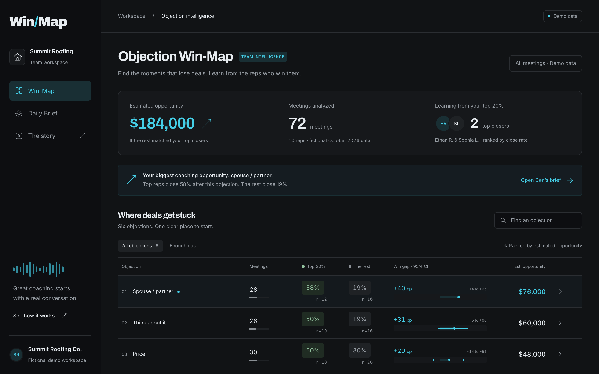
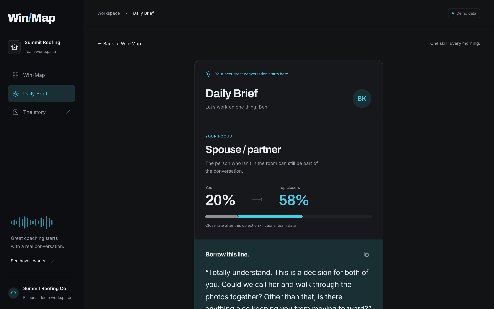
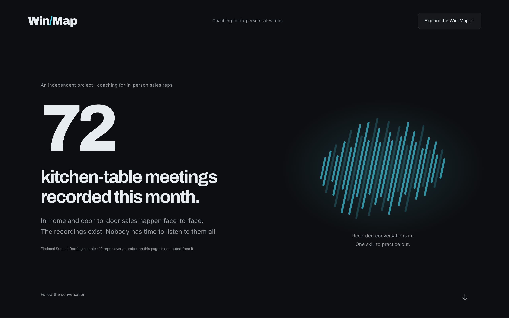
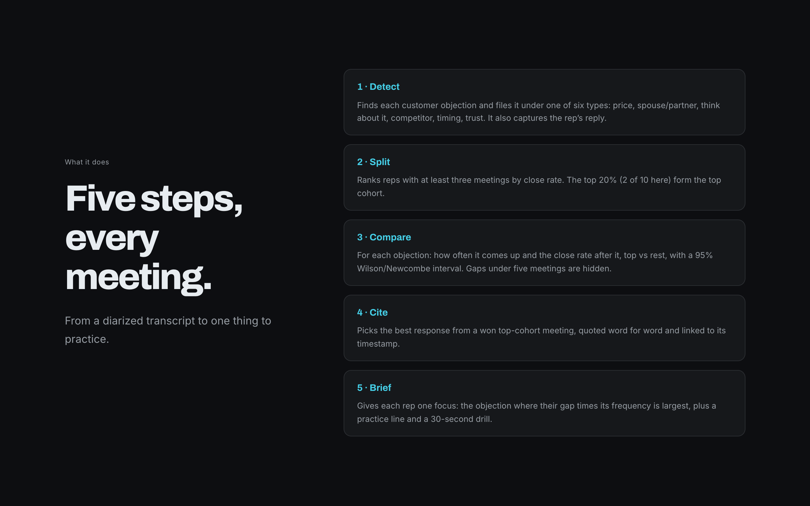
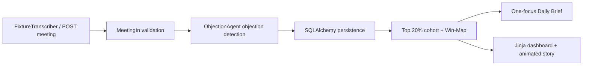

# Objection Win-Map

Learn from your top 20% closers, one objection at a time. An independent project for teams coaching in-person sales reps (in-home, showroom, door-to-door).

## The problem

In-person sales teams now record their kitchen-table meetings, but nobody has time to listen to them. A field manager can join one or two meetings a day, so coaching rests on a small sample and on memory. Users of popular call-recording and coaching tools in this space report that they get per-meeting feedback, but no team-level answer to the question managers actually ask: *which objection is costing us the most deals, and what do our best reps say instead?*

## The feature, and why this one

The **Objection Win-Map** compares the close rate of the top 20% of reps with everyone else after each of six objection types (price, spouse/partner, "think about it", competitor, timing, trust). It ranks objections by estimated recoverable revenue, shows uncertainty and sample sizes, and cites a verbatim response from a won top-rep meeting. The **Daily Brief** then gives each rep one focus, a missing tactic, a practice line, a 30-second drill and their own lost-meeting evidence.

Why this feature:

- **The answer is already on tape.** A team's own top closers handle each objection differently. The Win-Map finds where that difference costs the most.
- **Reps can change one thing at a time.** Coaching on ten behaviours at once does not stick, so the brief picks one.
- **Managers need proof, not a score.** Every number links to a real meeting and timestamp.

The alternative considered was a ranked coaching queue (which rep needs help first). A queue tells you *who* needs help. The Win-Map tells you *what* to practise and gives the exact words, so it serves both managers and reps.

## What it does

1. **Detect:** finds customer objections in diarized transcripts, classifies them into the six types, and captures the rep's reply.
2. **Split:** ranks reps with at least three meetings by close rate and takes the top 20% as the top cohort.
3. **Compare:** per objection, frequency and close rate after it for each cohort, with a Wilson/Newcombe 95% interval. Cells with fewer than five meetings are flagged and their gap hidden.
4. **Cite:** picks the best response from a won top-cohort meeting and links it to the transcript timestamp.
5. **Brief:** each rep gets the objection where (top rate - their rate) x their frequency is largest.

## Measured on the demo data

On the fictional Summit Roofing sample (10 reps, 72 meetings), the spouse/partner objection is the biggest gap: top reps close **58% (7/12)** after it, the rest **19% (3/16)**, a **+40 pp** gap worth **$76,000**. Across all objections with enough data the estimated recoverable total is **$184,000** for the month. Ben K. closes 1/5 (20%) of his spouse-objection meetings, so that is his Daily Brief focus. The detector classifies 406/406 labelled fixture utterances correctly (synthetic data, not a production accuracy claim).






## Routes

- `/` — interactive Win-Map, objection search, sample-size filter, expandable quotes, rep selector.
- `/reps/ben` — Ben K.’s Daily Brief, copyable practice line, timed drill, cited evidence.
- `/meetings/{id}#t-{seconds}` — actual seed transcript, with the cited moment highlighted.
- `/story` — seven scrolling sections: the problem, the visibility gap, the objection question, the feature and why, what it does, an animated before → after pipeline, and the computed impact.
- `/docs` — interactive OpenAPI documentation; `/health` — service health check.

## Run locally

Python **3.12** and [uv](https://docs.astral.sh/uv/) are recommended. No credentials or external service account is needed.

```sh
uv sync --frozen
uv run uvicorn objection_winmap.main:app --reload
```

Open <http://127.0.0.1:8000>. Startup seeds an empty database automatically. SQLite persists to `winmap.db` in the working directory. To explicitly load missing fixture records, run `uv run python -m objection_winmap.seed` (idempotent).

Using pip instead:

```sh
python3.12 -m venv .venv
source .venv/bin/activate
pip install .
uvicorn objection_winmap.main:app --reload
```

`.env.example` documents the configuration. The app reads **environment variables**, not a `.env` file automatically. For example:

```sh
AVG_DEAL_SIZE_USD=15000 uv run uvicorn objection_winmap.main:app
```

| Variable | Default | Meaning |
| --- | --- | --- |
| `DATABASE_URL` | `sqlite:///./winmap.db` | SQLAlchemy URL. `postgresql://...` and `postgres://...` normalize to the psycopg driver for Postgres/Supabase. |
| `AVG_DEAL_SIZE_USD` | `12000` | Finite positive team average for the opportunity calculation. |
| `WINMAP_LLM_MODEL` | empty | Reserved optional adapter setting. This build always uses the deterministic mock and never makes an LLM call. |
| `PORT` | `8000` in Docker | Container listening port, compatible with Cloud Run. |

Never put real credentials in tracked files. `.env`, databases, caches, virtual environments and build artifacts are ignored.

## Tests and production builds

```sh
uv run pytest
uv run ruff check .
uv build
docker build -t objection-winmap .
docker run --rm -p 8000:8000 objection-winmap
```

The production wheel includes Jinja templates, CSS/JS, design tokens and all seed fixtures; it can seed and serve from an installed package without the repository. The Dockerfile uses Python 3.12-slim, runs as a non-root user, and starts Uvicorn. GitHub Actions runs lint, tests, the wheel build and Docker build. Use a persistent database in a deployed container; Cloud Run’s local filesystem is ephemeral.

Optional browser validation (with the server running):

```sh
uv sync --group browser
uv run --group browser python scripts/check_browser.py
```

The script uses installed Google Chrome on macOS. On another OS, set `CHROME_EXECUTABLE` to an installed Chrome/Chromium executable, or install Playwright Chromium with `uv run --group browser playwright install chromium`. It checks 320/375/768/1280px layouts, filtering, evidence links, rep navigation, drill completion, Motion playback, reduced motion and no-JavaScript fallback; screenshots go to `artifacts/`.

Core tests were written before implementation. Coverage includes Wilson/Newcombe reference values and edge cases; cohort rounding, ties and the three-meeting guard; 12 handcrafted positive detector utterances plus negatives and priority conflicts; response attribution and distinct tactics; team isolation; repeat-objection deduplication; idempotent seeding; opportunity ranking and sample guards; Ben’s focus and verbatim citation; brief ties and empty states; ingestion/validation; HTML routes; and fixture classification accuracy. `tests/test_eval.py` prints a confusion matrix if accuracy falls below 90%.

## How the analysis works



The detector inspects customer utterances, labels the first matching objection, and captures the next one or two rep utterances, stopping before a subsequent objection. Specific spouse and competitor language takes priority over generic price language. Quality is the number of distinct response tactics plus 0.5 for a won meeting. Best responses come only from **closed** meetings in the top cohort; ties break by meeting ID and timestamp.

Reps need **three meetings** to enter the cohort ranking. The top `ceil(eligible reps × 0.2)` are selected, with ties broken by rep ID. Unranked reps still contribute to overall objection frequency, but neither cohort denominator. A meeting counts at most once per objection; it may contain multiple different objections.

Gaps use the **Newcombe hybrid score** difference interval from two Wilson 95% intervals. Either cohort having fewer than **five** affected meetings sets `sufficient_data=false`; the UI hides its gap and opportunity. API rows still expose the raw estimates with that flag for clients to handle explicitly.

`estimated opportunity = rest affected meetings × max(top rate − rest rate, 0) × average deal size`

These are **correlations, not causal effects**. No adjustment is made for territory, lead quality, rep effects or co-occurring objections. The headline sums sufficient-data rows; overlapping objections can double-count the same potential deal, so this is **not a revenue forecast**. The story’s “per month” wording refers to the fictional October seed sample, not an annualized forecast or a rolling-date filter. The dashboard includes all meetings, including later API submissions.

Brief focus is the largest positive `(top rate − personal rate) × personal objection frequency` among sufficient team cells with a usable quote; ties break alphabetically. A missing tactic is one the top cohort uses more frequently and the rep has not used in this objection’s responses. When no positive, supported focus exists, the brief shows an honest empty state.

## Seed and mocked services

**Summit Roofing Co. is fictional.** Its 10 reps and 72 kitchen-table roofing meetings are generated by `scripts/make_seed.py` with a fixed RNG seed. Each transcript has 8–20 diarized utterances, hail/roofing context, timestamps and an outcome. `seed/labels.json` has 406 gold customer-utterance labels, assigned by the fixture authoring process independently of the detector. This is a narrow synthetic evaluation, not a production accuracy claim.

The seed’s spouse/partner row has top reps at **7/12 (58%)**, the rest at **3/16 (19%)**, and **$76,000** estimated opportunity. Ben closes **1/5 (20%)** of his spouse-objection meetings and receives that focus. Price and “think about it” have smaller opportunity; competitor/timing/trust demonstrate the insufficient-data state.

- `Transcriber` / `FixtureTranscriber` stands in for Deepgram. It loads local transcripts; it does not process audio.
- `ObjectionAgent` / `HeuristicObjectionAgent` is a typed, PydanticAI-shaped protocol (`output_type`) with deterministic regex rules. The optional real PydanticAI adapter is intentionally not implemented; it is not needed for the demo.
- No LiveKit, Deepgram, ElevenLabs, LLM, Supabase or other proprietary service is contacted. Google Fonts and Motion are public UI CDNs. If unavailable, readable system fallback fonts and static final states remain.

## Stack and design

Python 3.12 · FastAPI · Pydantic v2 · SQLAlchemy 2.0 · SQLite by default, PostgreSQL/Supabase-compatible URL support · Jinja2 · hand-written CSS · Motion **11.11.17** vanilla CDN build · pytest/httpx · Ruff · Docker · GitHub Actions.

The backend is a typical Python agent stack for this space (FastAPI, Pydantic, a PydanticAI-shaped agent seam, Postgres). The UI is server-rendered. Slate and cyan tokens live in `tokens.css`; Archivo display and Inter body typography. Keyboard focus, native disclosure controls, mobile layouts and `prefers-reduced-motion` are supported. Motion uses entrance reveals, staggered cohort dots/chips, [scroll-linked paths](https://motion.dev/docs/scroll), and numeric counters. See [Motion’s inView documentation](https://motion.dev/docs/inview).

Screenshots live in `docs/`. Local browser-validation artifacts, when generated, live in ignored `artifacts/`.

**Built with Codex, verified by Claude Code.** An independent project. This unauthenticated demo is intended for local evaluation with fictional data.

> CI: the GitHub Actions workflow (ruff + pytest + docker build) lives at `ci/github-actions-ci.yml`. Copy it to `.github/workflows/ci.yml` to enable it. It was published outside that folder because the publishing token lacks the `workflow` scope.
